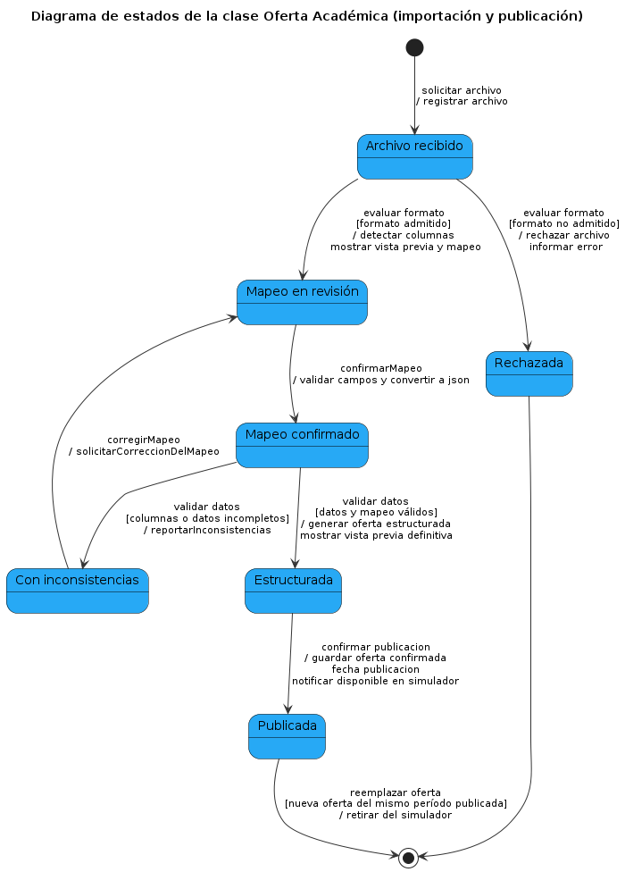
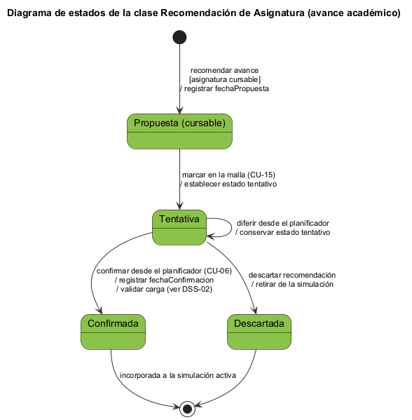

# Diagramas de estado
 
## EST-01 — Ciclo de vida de Oferta Académica
- Clase del dominio: [Oferta Académica](./08-modelo-dominio.md)
- Diagramas de secuencia relacionados: [DSS-01](./10-diagramas-secuencia.md)
 

 
Archivo fuente: [`./diagramas/est-01.puml`](./diagramas/est-01.puml)
 
### Tabla de transiciones
| Estado origen | Evento | Guarda | Acción | Estado destino |
|---------------|--------|--------|--------|----------------|
| Inicio | solicitar archivo | -| registrar archivo | Archivo recibido |
| Archivo recibido | evaluar formato | formato admitido | detectar columnas / mostrar vista previa y mapeo|Mapeo en revisión|
| Archivo recibido | evaluar formato | formato no admitido | rechazar archivo / informar error| Rechazada|
| Mapeo en revisión | confirmar mapeo | — | validar campos y convertir a JSON | Mapeo confirmado|
|Mapeo confirmado | validar datos | datos y mapeo válidos | generar oferta estructurada / mostrar vista previa definitiva| Estructurada |
|Mapeo confirmado | validar datos | columnas o datos incompletos | reportar inconsistencias| Con inconsistencias|
|Con inconsistencias | corregir mapeo | — | solicitar corrección del mapeo| Mapeo en revisión|
|Estructurada | confirmar publicación | almacén confirma el registro | guardar oferta confirmada / fecha publicación / notificar disponible en simulador| Publicada |
|Publicada | reemplazar oferta | nueva oferta del mismo período publicada | retirar del simulador| fin |
|Rechazada | — | — | — | fin |

## EST-02 — Ciclo de vida de Recomendación de Asignatura (avance académico)
- Clase del dominio: [Recomendación de Asignatura](./08-modelo-dominio.md#después-de-los-cambios) (`estado`, `fechaPropuesta`, `fechaConfirmacion`)
- Cambio: [EVALUACION2.md](./EVALUACION2.md)
- Diagrama de secuencia relacionado: [DSS-03](./10-diagramas-secuencia.md#dss-03--registro-y-confirmación-de-asignatura-en-estado-tentativo-evaluación-2)

Archivo fuente: [`./diagramas/est-02.puml`](./diagramas/est-02.puml)

### Tabla de transiciones
| Estado origen | Evento | Guarda | Acción | Estado destino |
|---------------|--------|--------|--------|----------------|
| Inicio | recomendar avance | asignatura cursable | generar recomendación / registrar `fechaPropuesta` | Propuesta (cursable) |
| Propuesta (cursable) | marcar en la malla (CU-15) | — | establecer estado `tentativo` | Tentativa |
| Tentativa | diferir desde el planificador | — | conservar estado `tentativo` | Tentativa |
| Tentativa | confirmar desde el planificador (CU-06) | — | registrar `fechaConfirmacion` / validar carga (ver DSS-02) | Confirmada |
| Tentativa | descartar recomendación | — | retirar de la simulación | Descartada |
| Confirmada | — | incorporada a la simulación activa | — | fin |
| Descartada | — | — | — | fin |
 
